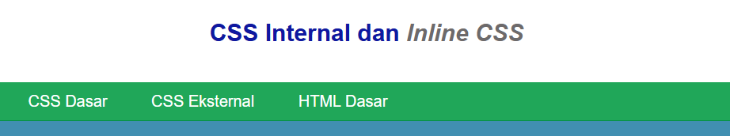
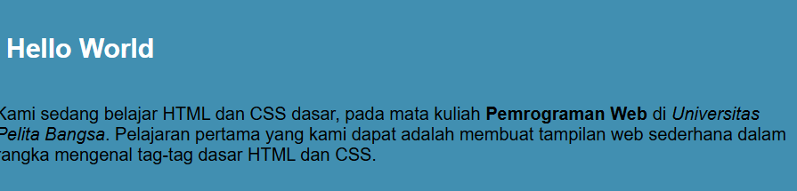
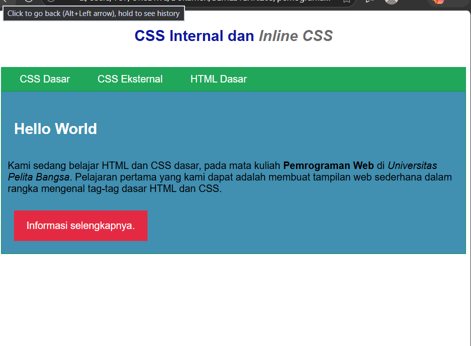

Hasil CSS Internal:

3. Menambahkan Inline CSS

Menambahkan atribut style secara langsung pada tag paragraf 
 untuk mengubah tata letak dan warna teks.

Hasil Inline CSS:

4. Membuat dan Menyisipkan CSS Eksternal (style_eksternal.css)

Membuat file CSS terpisah bernama style_eksternal.css untuk mengatur tampilan navigasi, lalu memanggilnya di dalam tag <head> menggunakan tag <link>.

Aturan CSS (style_eksternal.css):

nav {
  background: #20A759;
  color: #fff;
  padding: 10px;
}
nav a {
  color: #fff;
  text-decoration: none;
  padding: 10px 20px;
}
nav .active,
nav a:hover {
  background: #0B6B3A;
}

Pemanggilan di HTML:

<link rel="stylesheet" href="style_eksternal.css" type="text/css">

Hasil Eksternal CSS:

5. Menambahkan CSS ID dan Class Selector

Menambahkan gaya untuk kontainer ID #intro serta Class .button dan .btn-primary di dalam file style_eksternal.css.

/* ID Selector */
#intro {
  background: #418fb1;
  border: 1px solid #099249;
  min-height: 100px;
  padding: 10px;
}
#intro h1 {
  text-align: left;
  border: 0;
  color: #fff;
}

/* Class Selector */
.button {
  padding: 15px 20px;
  background: #bebcbd;
  color: #fff;
  display: inline-block;
  margin: 10px;
  text-decoration: none;
}
.btn-primary {
  background: #E42A42;
}

Hasil Akhir Praktikum:

(Tambahkan gambar screenshot hasil akhir di sini)

